# DJ Mantra — Manual

DJ Mantra is a DJ app for Android phones, made for long, smooth blends: two decks, a mixer that only cuts, phrase lights that show beat 1 of every 8-beat phrase, and sections that show where the music changes. It runs on the open-source Mixxx 2.5 engine and works with the Hercules DJControl Mix Ultra controller over USB or Bluetooth.

This manual has two parts: **how to use the app**, then **the technology behind it**. Menu → MANUAL shows it in the app; EXPORT MD and EXPORT PDF save it to *Documents/DJ Mantra/Manual*, where it can be printed.

*The pictures are drawn from the app's own screens (its interface files, with sample songs), at the size of a Pixel 7.*

---

# Part 1 — Using DJ Mantra

## 1. First start

1. Install the APK and open DJ Mantra.
2. Allow **All files access** when Android asks: the app reads your music and writes its documents.
3. Put your music anywhere under **Music** (or in *Music/djmantra_app*). The app analyses every song once: tempo (BPM), beat grid, key, sections and loudness.
4. Connect the controller (optional): Menu → **CONTROLLER: USB** or **CONTROLLER: BLUETOOTH**.

## 2. The screen

The top half is always the same, whatever tab is open:

- **Top bar**: the menu (☰), the two decks' keys and whether they match (e.g. *11B > 12B, +1 energy up*), the clock, the CPU / GPU load and the battery. Long press on the clock starts or stops recording (the clock turns red).
- **Deck headers**: cover, title, artist and key of each deck. Tap a cover to load the highlighted song into that deck.
- **Transport**: SYNC, CUE, PLAY / PAUSE and NEXT for each deck.
- **Modes**: AUTOMIX, EQ, TEMPO BLEND, AUTO PHASE and the beats selector (8 / 16 / 32).
- **The matrix display**: per deck the time left, the countdown to the next section and the bar.beat, with the running phrase lights.
- **Overview lanes**: each song's whole waveform, with its sections.
- **Crossfader** at the bottom, then the five tabs: **Songs, Phrasing, Mixer, AutoMix, Keys**. The controller's pad-mode buttons switch the same tabs.

Every change made with a finger shows a short message (a *toast*) above the controls, because the finger covers what it moves. Every long press is 1 second. Nothing snaps: resets and automatic moves glide.

## 3. Songs

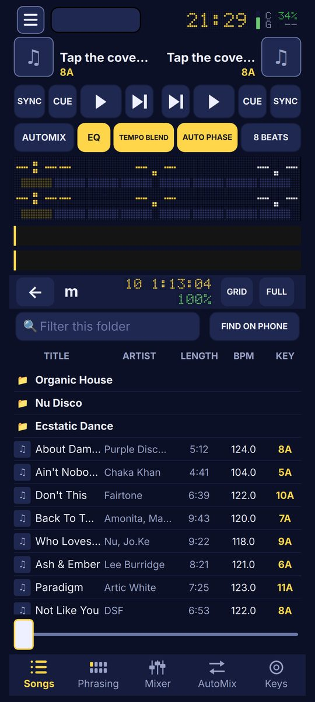

- Folders and songs, with **TITLE, ARTIST, LENGTH, BPM, KEY** columns; tap a column to sort by it.
- **Tap a song**: it loads into the free deck (the one not playing; when none plays, deck 1, deck 2, deck 1 ...). A playing deck is never replaced.
- **Long press a song**: add it to a playlist.
- **Find a song** filters this folder; **FIND ON PHONE** searches all your music.
- **Playlists** is a folder like the others; empty folders and playlists are hidden.
- **SUNO**: paste links to your Suno songs; **GET** opens Suno (log in once) and saves the song you download there to *Music/djmantra_app/Suno*.
- **TIDAL**: your TIDAL playlists (import into the app), send an app playlist to TIDAL, or SYNC ALL.
- **FULL** gives the list the whole screen.

## 4. Phrasing

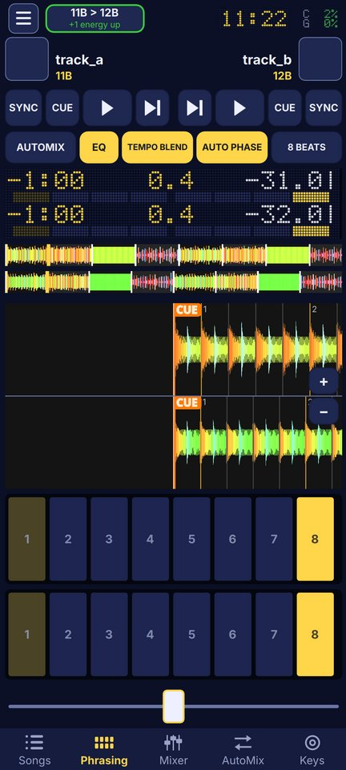

- The two decks' scrolling waveforms, one over the other, with the same zoom (**+ / −**), so the beats line up by eye. Bar lines are numbered.
- **Phrase pads 1–8** for each deck: the lit pad is the current beat of the 8-beat phrase. On a stopped deck, tap pad N to start it from its phrase beat N, in time with the other deck.
- Drag the waveform to move through the song.

## 5. Mixer

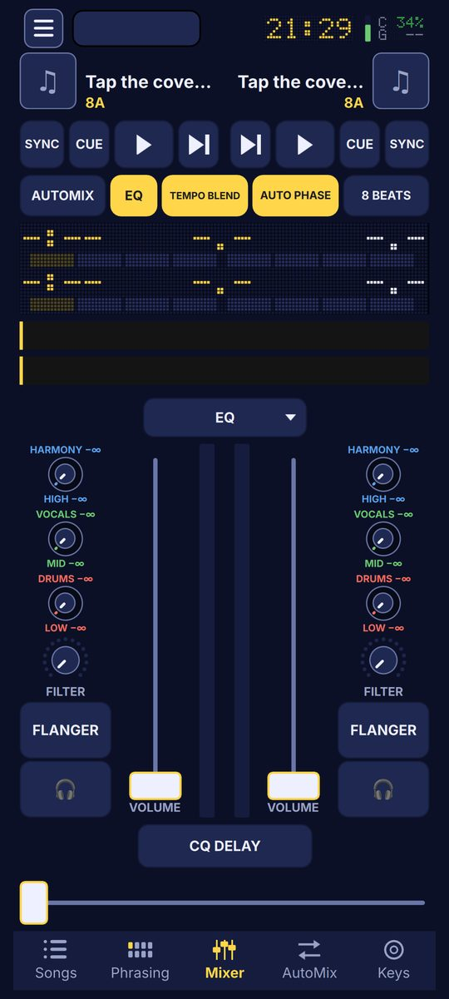

- **EQ / NEURAL MIX** at the top switches what the knobs do: the **Equalizer** (HIGH, MID, LOW) or **Neural Mix** (HARMONY, VOCALS, DRUMS).
- Each knob is **concentric**, like a big studio mixer's: the inner knob is the active mode, the outer ring the other mode. A finger turns the inner knob; the controller turns both (SHIFT for the outer). Both labels share one colour: HIGH / HARMONY blue, MID / VOCALS green, LOW / DRUMS red.
- **All EQs only cut**: the top is 0 dB, turning down cuts to a full kill. There is no boost. Long press resets to 0 dB.
- **FILTER** (bottom knob): a Pioneer DJM filter. Middle is off, left is a low-pass, right a high-pass. Long press resets it.
- **FX button**: tap = the deck's effect on / off; hold = choose the effect (FLANGER, UNDERWATER, COOLDOWN, ECHO OUT, DJM DELAY, DJM ECHO, DJM TRANS, DJM PAN) and its DEPTH.
- **Volume faders** and the **headphones** (🎧) buttons for each deck. Long press a fader to use it as the PITCH fader.
- Loading a new song resets its EQs and Neural Mix, so every song starts clean.

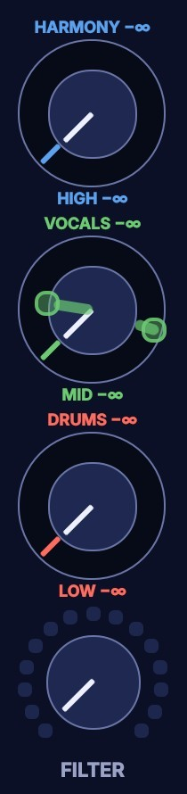

**Ghosts.** A knob on the controller does not make the screen's value jump: until the hardware knob reaches the value (or passes it), a **half-transparent ghost** shows where the hardware knob is. Then they move together. This works for the EQ knobs, FILTER and the effect depth.

## 6. AutoMix

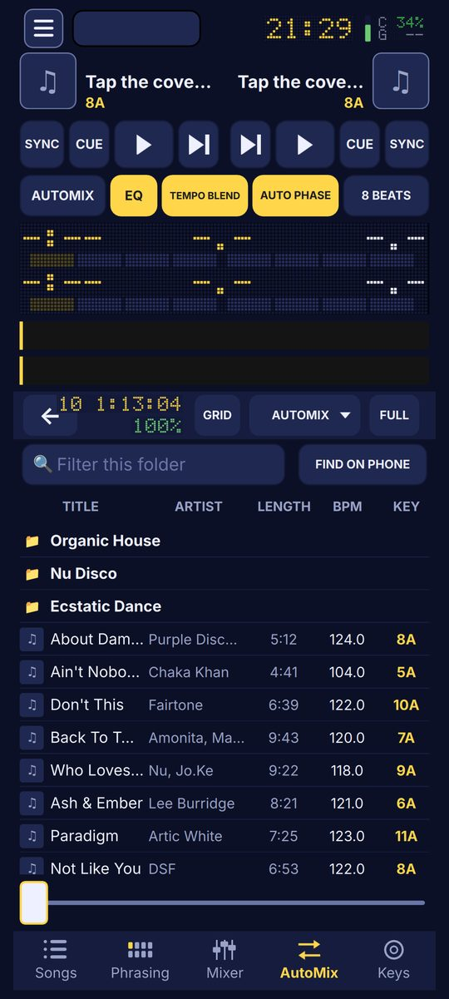

AutoMix plays the current folder or playlist by itself, song after song. Open the **AUTOMIX** menu to set it and START or STOP; PREVIOUS SONG / NEXT SONG choose what comes next. The **AUTOMIX** button above the matrix is a single action: it glides the crossfader to the other deck over the time set in Settings (in beats or seconds), while **EQ** and **TEMPO BLEND**, when lit, follow the crossfader:

- **EQ** swaps the bass first, then the highs, then the mids.
- **TEMPO BLEND** glides the tempo from the outgoing song's to the incoming song's.
- **AUTO PHASE** starts the incoming deck on beat 1 of the playing deck's phrase.

## 7. Keys

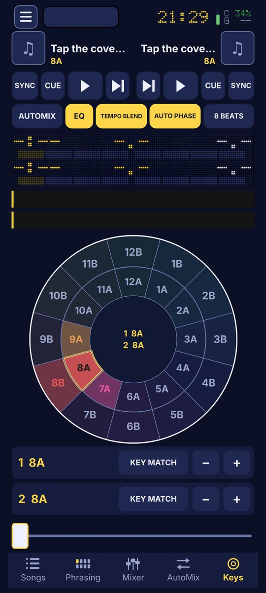

- The **Camelot wheel**: each deck's key is lit; neighbours on the wheel mix well.
- **KEY MATCH** shifts a deck to the matching key; off, it goes back to its own key. **− / +** move the key a semitone.

## 8. The menu

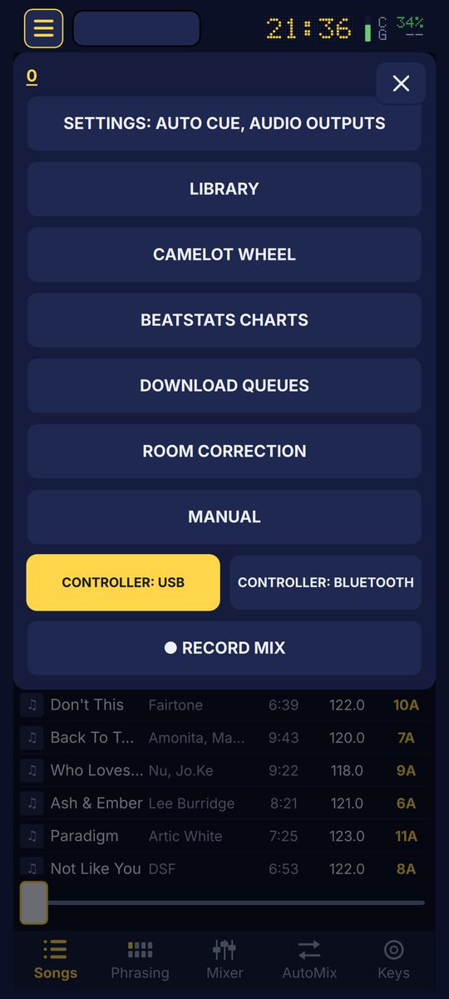

- **SETTINGS** (auto cue, audio outputs, waveform style, tempo range, controller, TIDAL login, recording ...).
- **LIBRARY**, **CAMELOT WHEEL**: the Songs and Keys tabs.
- **BEATSTATS CHARTS** (section 10), **DOWNLOAD QUEUES** (section 10), **ROOM CORRECTION** (section 11).
- **MANUAL**: this manual. **EXPORT MD** saves it with its pictures, **EXPORT PDF** as a printable PDF (A4), both to *Documents/DJ Mantra/Manual*.
- **CONTROLLER: USB / BLUETOOTH**: one link at a time.
- **RECORD MIX**: records what plays, lossless (FLAC or WAV), to *Music/djmantra_app/Recordings*.

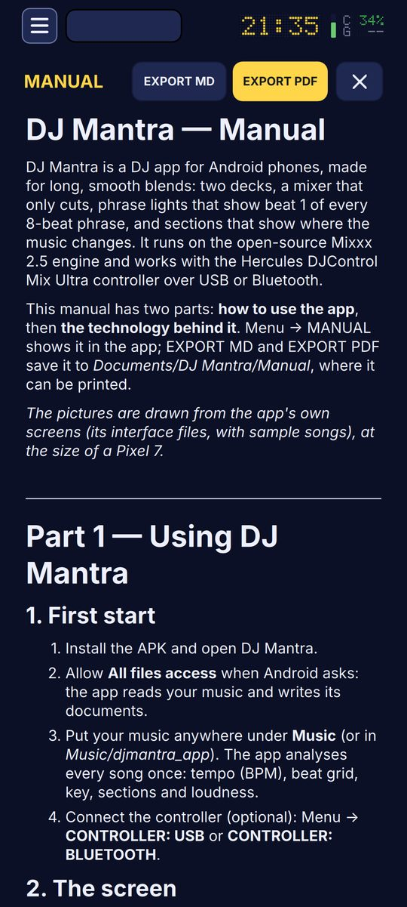

## 9. Settings

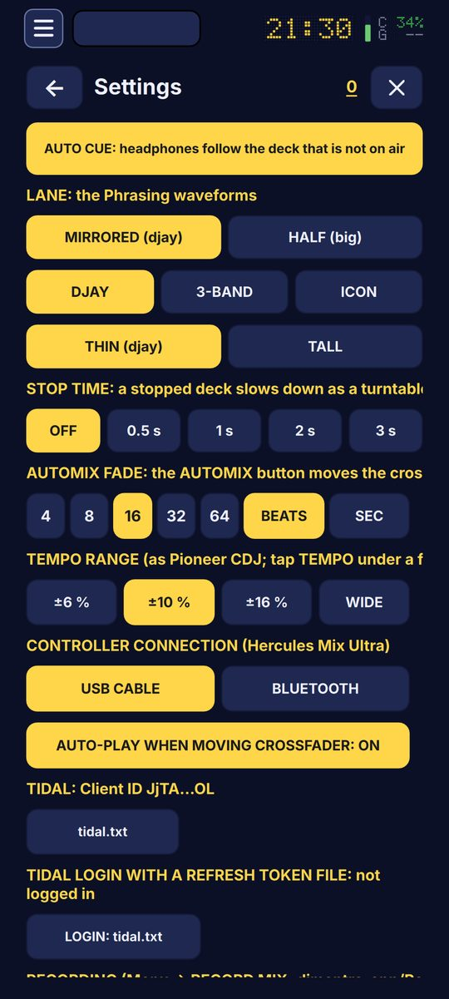

The most used:

- **AUTO CUE**: the headphones follow the deck that is not on air.
- **LANE**: the Phrasing waveforms mirrored (djay) or half (big); the **waveform style** DJAY (djay's colours), **3-BAND** (bass red, mids green, highs blue as layers, so sections show in the shape) or **ICON** (one colour a bar); THIN or TALL lanes.
- **STOP TIME**: a stopped deck slows down like a turntable (off, 0.5–3 s).
- **AUTOMIX FADE** in beats (4–64) or seconds.
- **TEMPO RANGE** ±6 / ±10 / ±16 % / WIDE, like a Pioneer CDJ.
- **CONTROLLER CONNECTION**, **AUTO-PLAY WHEN MOVING CROSSFADER**.
- **TIDAL**: the Client ID key file, and **LOGIN WITH A REFRESH TOKEN FILE** (section 10).
- **RECORDING**: format and file name.
- **CQ MIXER**: the delay of a connected CQ mixer in time with the music.

## 10. BeatStats charts, TIDAL and the download queues

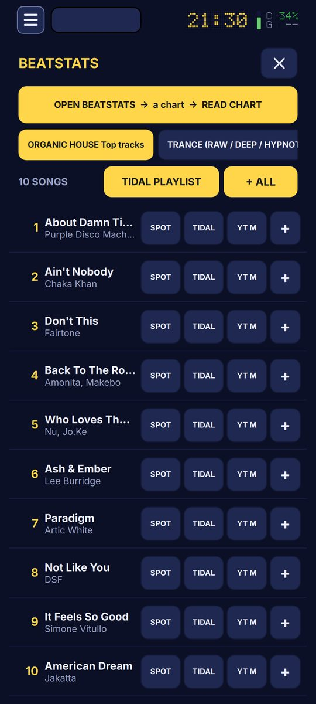

**Read a chart**

1. Menu → **BEATSTATS CHARTS** → **OPEN BEATSTATS**. beatstats.com opens in the app's browser. Pass its "Verify you are human" check once (it is remembered).
2. Open a chart (a genre's TRACKS list) and tap **READ CHART**. The app reads rank, title, artist and the Beatport ID of every song, then each song's ISRC (the code of the exact recording).
3. **CAPTURE** saves the whole page as one tall JPEG.

**From a chart**

- **SPOT / TIDAL / YT M**: open the song in Spotify, TIDAL or YouTube Music.
- **+**: add one song to a download queue; **+ ALL**: the whole chart at once.
- **TIDAL PLAYLIST**: the whole round in one tap:
  1. the chart becomes the TIDAL playlist **"BeatStats – *chart name*"** (unlisted). Each song is found by its ISRC, else by a careful search: the same song in another version if the named remix is not on TIDAL, never another song;
  2. the chart's songs that are **on your phone** go into the app playlist of the same name, ready for the decks;
  3. the others go into the **TIDAL download queue**.

**TIDAL login.** Settings → TIDAL. Either the browser login, or put a text file with your TIDAL **refresh token** (a line `TIDAL_REFRESH_TOKEN=...`, or the token alone) into *Documents/DJ Mantra/Keys* and tap **LOGIN:** followed by the file's name. The token is kept by the app and never shown.

**TIDAL plays 30-second previews in other apps.** TIDAL gives DJ Mantra only previews, so songs play in the decks from your phone's files. Full TIDAL streaming in a DJ app needs TIDAL's DJ partnership.

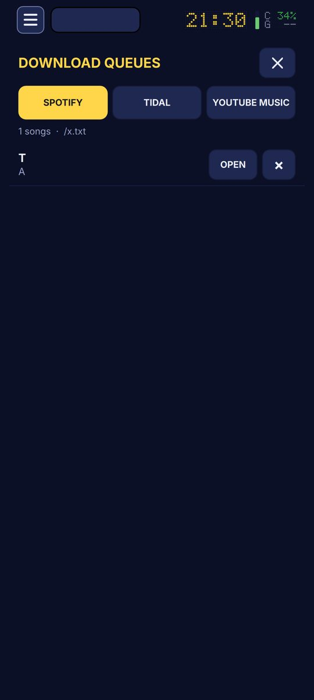

**Download queues**: one text file per service (Spotify, TIDAL, YouTube Music), one line a song: *Artist | Title | link*. Open a link to buy or download the song.

## 11. Room correction

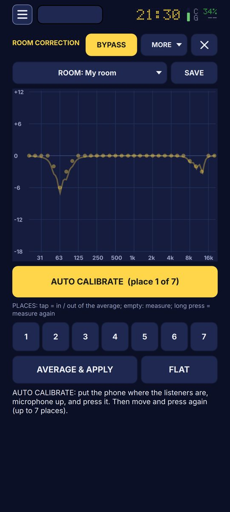

Corrects the speakers for the room, like IK Multimedia's ARC.

1. Connect the speakers. Choose the microphone in MORE (the phone's, or a USB measurement microphone).
2. Put the phone where the listeners will be and tap **AUTO CALIBRATE**: the speakers play a sweep, the phone listens.
3. Move and repeat, up to **7 places** (tap a place to include it or not; long press measures it again).
4. **AVERAGE & APPLY**: the correction goes onto the main output (not onto the recording). **BYPASS** compares; **FLAT** clears it.
5. **SAVE** keeps the room (several rooms can be saved, chosen at the top).

MORE also holds the target (FLAT, HOUSE, CLUB), the strength (50 / 75 / 100 %), the test signal and its level, a live analyser and a short guide.

## 12. The Hercules DJControl Mix Ultra

| Control | Does |
|---|---|
| PLAY, CUE, SYNC | as on screen; SHIFT + PLAY = stutter, SHIFT + CUE = back to the start, SHIFT + SYNC = key lock |
| LOAD | loads the highlighted song; SHIFT + LOAD = eject |
| BROWSE turn / press | opens the song list, moves, loads |
| Jog wheel | touch the top to scratch, turn the ring to nudge; SHIFT + top = fast seek |
| HIGH / MID / LOW | the EQ (or Neural Mix in that mode); with SHIFT the other mode; with pickup and ghosts |
| FILTER | the filter, with pickup; **SHIFT + FILTER = the depth of the deck's effect** (a pop-up shows its fader) |
| Pad mode buttons | HOT CUE = Songs, LOOP = Phrasing, FX = Mixer, NEURAL MIX = AutoMix, SHIFT + NEURAL MIX = Keys |
| **SHIFT + FX (FX pads)** | pads 1–8 = the 8 effects on that deck: tap = on / off, hold = only while held; SHIFT + pad = effects 9–16 |
| NEURAL MIX pads | 1–3 kill low / mid / high, 4 filter reset, 5–8 jump to beats 5–8; SHIFT + pad 5 = "1 is here" |
| LOOP pads | beat loops ¼ – 32 beats; SHIFT = loop rolls |
| SAMPLER pads | play samplers 1–8; SHIFT = stop |

In every pad mode the pads light the current beat of the 8-beat phrase (the FX pads light the effect that is on).

## 13. Where the files are

| What | Where |
|---|---|
| Your music | *Music* (and *Music/djmantra_app*) |
| Playlists | *Music/djmantra_app/Playlists* |
| Suno songs | *Music/djmantra_app/Suno* |
| Recordings | *Music/djmantra_app/Recordings* |
| BeatStats charts, captures, saved pages | *Documents/DJ Mantra/BeatStats* |
| Download queues | *Documents/DJ Mantra/Download_Queue* |
| Rooms | *Documents/DJ Mantra/Room_Corrections* |
| Key and token files | *Documents/DJ Mantra/Keys* (or Download, Documents) |
| This manual, exported | *Documents/DJ Mantra/Manual* |

Every time the app saves a file, a message says its name and folder.

---

# Part 2 — The technology

## 14. The engine

DJ Mantra is built on **Mixxx 2.5**, the open-source DJ software (GPL), ported to Android: the same audio engine (decks, mixer, effects, time-stretching, sync), its library and analysis, compiled for the phone's ARM processor with the Android NDK and Qt 6. The interface is new, written in **Qt Quick** (QML) for a phone held upright; Mixxx's desktop screens are not used. Sound goes out through Android's low-latency audio (Oboe / AAudio), to the phone, a USB sound card or a USB-C audio output, with the headphones on a second output when there is one.

## 15. Analysis

Each song is analysed once, in the background, and the results are kept in the library:

- **Beats and BPM**: a beat grid; the first beat of the grid is placed on the kick.
- **Key**: shown in Camelot notation (8A, 11B ...) for harmonic mixing.
- **Sections**: where the arrangement changes (bass in or out, vocals in or out, a new pattern), found from changes in the sound along the beat grid and aligned to the 8-bar phrase grid. The app counts down to the next change; it does not name the sections. Settings has options for how sensitive the detection is.
- **Loudness**: every song is normalised so its peak sits at **−1 dBFS** (quiet songs raised, loud ones lowered, within ×¼ … ×8), so songs play equally loud and the faders set the volume. There is no GAIN knob.

## 16. The waveforms

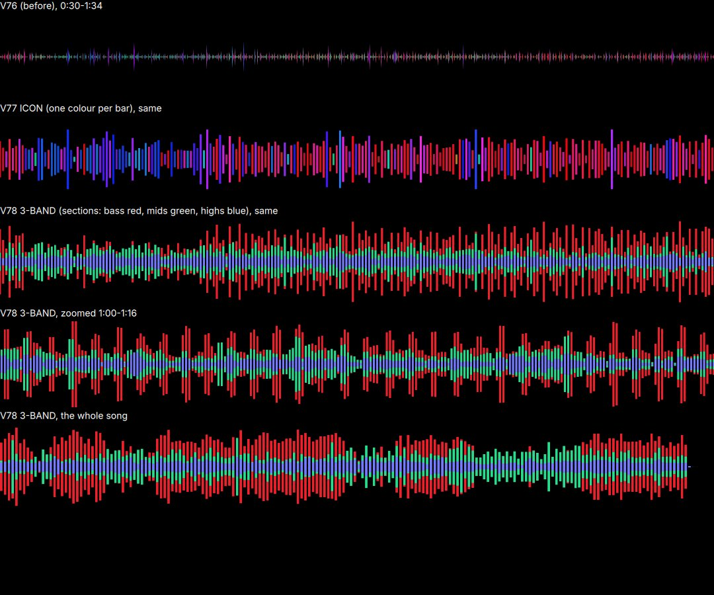

The scrolling waveform is drawn by the graphics processor (a fragment shader) from the analysis: for every moment the energy in three bands, **bass** (below 600 Hz), **mids** and **highs** (above 4 kHz). The bars are solid and sharp to the device pixel, and they belong to the song, so they do not shimmer while scrolling. Three styles:

- **DJAY**: djay's mixed colours (the default).
- **3-BAND**: three nested layers per bar, bass red at the back, mids green, highs blue-violet in front. The colours never mix, so a breakdown (no red), a drop (wide red) or vocals (green) read as blocks: sections show in the shape itself.
- **ICON**: one pure colour per bar, as in the app's icon.

At deep zoom the real sound wave is drawn as a thin line.

## 17. The mixer

- **EQ and Neural Mix** are one effect of DJ Mantra's own (StemEQ), working on a short-time spectrum (FFT of 1024 points, about 23 ms): one mask per frequency, the masks adding up to the original sound at 0 dB.
  - **EQ**: three bands split at the mixer's EQ frequencies, cut only: the whole travel of the knob (127 steps on the controller) is spent on cutting, fine near 0 dB.
  - **Neural Mix**: **drums** = what is short in time (harmonic / percussive separation), **vocals** = what is steady and in the middle of the stereo image (150 Hz – 7 kHz), **harmonies** = the rest. It is light signal processing that runs on any phone, not a neural network, so the separation is approximate.
  - Both sets act together; the two rings of each concentric knob are the two sets.
- **FILTER**: modelled on the Pioneer DJM filter (resonant low-pass and high-pass, off in the middle).
- **Effects**: Mixxx's beat-synced effects with DJM-like settings, plus DJ Mantra's UNDERWATER, COOLDOWN and ECHO OUT.

## 18. Room correction

The speakers play a **logarithmic sine sweep**; the phone records it, and the room's response is found by dividing out the sweep (Farina's method), gated to the first 0.68 s so late reflections do not count. It is read in **31 third-octave bands**. The places are averaged by power, compared with the target curve relative to 200 Hz – 2 kHz, limited (no correction below the speakers' lowest usable frequency or above 16 kHz, at most −12 / +6 dB), smoothed, shifted so the correction only cuts, and applied at the chosen strength through a 31-band parametric equaliser on the main output. A quiet or implausible measurement is refused rather than applied.

## 19. The controller

The Mix Ultra speaks MIDI over USB or Bluetooth LE. Its mapping is a script: the knobs are read in 14-bit resolution; EQ, FILTER and the effect depth use **pickup** (a knob takes over only when it reaches the value, as in Ableton Live), and the app shows the **ghost** of a knob that has not picked up yet. The pad lights show the phrase (one pad per beat).

## 20. TIDAL, BeatStats and the playlists

- **TIDAL**: the official TIDAL API (OAuth 2.1 with PKCE, no secret in the app). Songs are found by **ISRC** first; without one, a ladder of searches from exact to loose; a match needs the same title and one of the artists, prefers the named version, then the original, and never takes another song, a cover or a karaoke version. Requests wait when TIDAL says "too many requests". Playlists are created unlisted, and sending a list again never adds a song twice.
- **BeatStats**: read from the page in the app's own browser (no OCR, no AI): the exact rows, then each song's ISRC from its Beatport page.
- The same matching is used by the *Playlist Generator* that makes TIDAL playlists from reference songs; both are described in the Mantra Manifest (*modules/tidal-playlists.md*).

## 21. Limits

- TIDAL gives this app **30-second previews** only; full songs play from the phone's files.
- beatstats.com and Beatport protect themselves with Cloudflare: the first visit needs a person to pass the check.
- Neural Mix separates drums, vocals and harmonies by signal processing, not by a neural network: the separation is approximate.

*DJ Mantra — built on Mixxx (GPL). This manual describes version V86.*
